# 泓问小程序 DevTools Automator 运行时测试报告

- 生成时间：2026-11-19T13:32:10.546Z
- AppID：wxd152caad9f9c76ef（品牌「泓问」）
- 自动化端口：ws://localhost:9420（WeChat DevTools，platform=devtools）
- 后端：harness 自有 Django 服务 http://127.0.0.1:8001（共享 dev SQLite 与 SECRET_KEY）
- 汇总：PASS 10 / FAIL 0 / MANUAL 1（共 11 项）

## 环境与 provider 实测说明

- **Qwen/DashScope 账户欠费（Arrearage）**：primary embed（text-embedding-v4）、primary TTS（cosyvoice-v3-flash）、primary ASR（qwen3-asr-flash）调用返回 HTTP 400 Arrearage。
- **Volcengine 正常**：primary text/omni/vision（doubao-seed-2-0-lite-260428）流式聊天实测打通；backup embed（doubao-embedding-vision-251215）用于 triage 种子与匹配；TTS 自动回退到 volcengine/seed-tts-2.0 实测合成成功。
- 因 primary embed 欠费且用户的 :8000 服务不可重启，harness 另起 :8001 服务并以进程级 `PRIMARY_EMBED_MODEL=volcengine/doubao-embedding-vision-251215` 覆盖（**不修改仓库 .env / config/env.js**），客户端经 automator `evaluate` 运行时把 API origin 指向 :8001。
- triage 种子：playbooks=["no-internet"], steps=11, customer_id=1。
- 流式必须连真 Django：`mockWxMethod('request')` 无法伪造 enableChunked 分帧，项 5/8 的打字机与重答均走真实 SSE。

## 逐项结果

| # | 项目 | 方式 | 状态 |
| --- | --- | --- | --- |
| 1 | wx.login 新/老用户登录 | auto | **PASS** |
| 2 | 头像昵称授权 (getUserProfile -> update_wx_user) | mock | **PASS** |
| 3 | 手机号授权横幅 (getPhoneNumber -> get-phone) | mock | **PASS** |
| 4 | 会话抽屉 CRUD（新建/切换/重命名/删除当前自动 bootstrap） | auto | **PASS** |
| 5 | 流式回复 / quick_replies / 附件预览 | auto | **PASS** |
| 6 | 语音录制（电平/取消/发送/转写/自动朗读） | manual | **MANUAL** |
| 7 | TTS 两路径（speak/stream 与 speak 回退）/ 停止 | mock | **PASS** |
| 8 | 重答 regenerate（仅最新可用 / 失败回滚） | auto | **PASS** |
| 9 | 图片上传（压缩 <=15MB / pending / 随文字 mixed 提交） | mock | **PASS** |
| 10 | 401 刷新（有效 refresh 重试 / 无效 refresh 回登录页） | auto | **PASS** |
| 11 | 刘海屏自定义导航栏 / 胶囊对齐 / 抽屉顶部 | mock | **PASS** |

### 1. wx.login 新/老用户登录 — PASS

- 方式：auto 耗时：14735ms
- 断言/证据：
  - new_user: data.isNewUser=true, button "授权登录" present
  - old_user: wx_login status ok -> redirectTo /pages/chat/chat, bootstrap session_id=pc_sess_3bc2202e3301
- 截图：
  - 
  - 

### 2. 头像昵称授权 (getUserProfile -> update_wx_user) — PASS

- 方式：mock 耗时：11393ms
- 断言/证据：
  - update_wx_user persisted nickname="泓问头像昵称测试" to storage and HongwenProfile.nickname
  - MANUAL(真机): 微信自 2022-10-25 起 getUserProfile 返回匿名资料(微信用户/灰色头像)，属预期；真机扫码验证授权弹窗与匿名资料展示。
- 截图：
  - 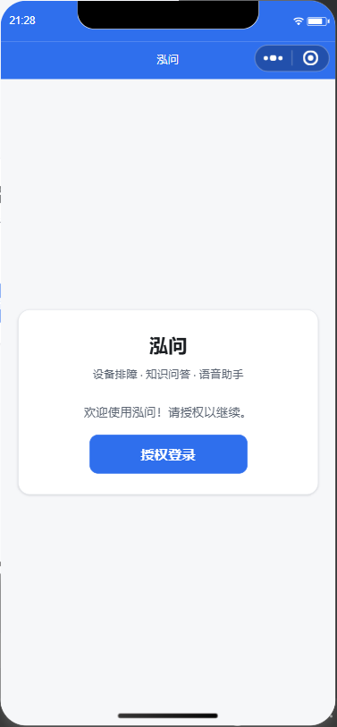
  - 
- 真机手测：
  - [ ] 真机授权弹窗 + 匿名资料展示（2022-10-25 起预期）

### 3. 手机号授权横幅 (getPhoneNumber -> get-phone) — PASS

- 方式：mock 耗时：8927ms
- 断言/证据：
  - real backend branch: /auth/get-phone fake code -> HTTP 400 "获取手机号失败"
  - mock success branch: getPhoneNumber:ok -> get-phone 200 -> hasPhone=true, has_phone stored, banner hidden
  - MANUAL(真机): 原生手机号授权弹窗不可驱动，需真机扫码点击横幅验证真实 code 换取手机号。
- 截图：
  - 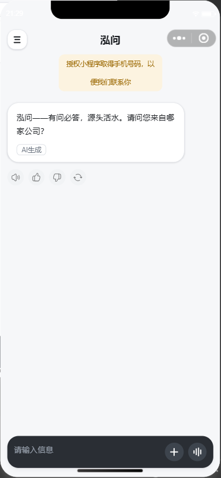
  - 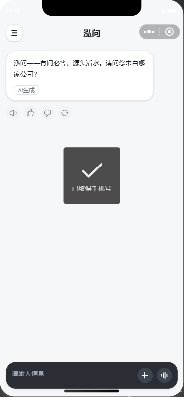
- 真机手测：
  - [ ] 真机原生手机号授权弹窗 -> 真实 get-phone 换号

### 4. 会话抽屉 CRUD（新建/切换/重命名/删除当前自动 bootstrap） — PASS

- 方式：auto 耗时：7991ms
- 断言/证据：
  - new: force_new created session pc_sess_1bdf2bdfe08d (previous pc_sess_3d737422458c)
  - select: tapped .session-item-main -> currentSessionId=pc_sess_3d737422458c
  - rename: editable modal -> PATCH title="自动化重命名会话" reflected in drawer
  - delete-current: deleted pc_sess_3d737422458c -> auto bootstrap currentSessionId=pc_sess_1bdf2bdfe08d, removed from list
- 截图：
  - 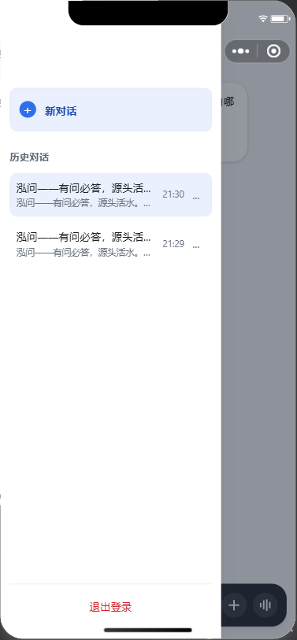
  - 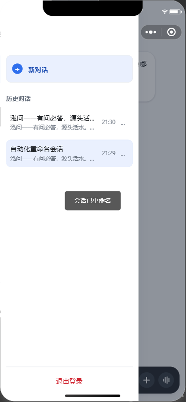
  - 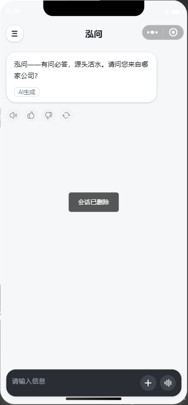

### 5. 流式回复 / quick_replies / 附件预览 — PASS

- 方式：auto 耗时：25824ms
- 断言/证据：
  - typewriter: reply 300 chars, 4 incremental growth samples over 89 polls (real SSE deltas)
  - KB empty (no documents ingested) -> used_knowledge_base=false; typewriter still works on pure provider stream
  - quick_replies: triage intake chips [iPad / iPhone | Windows 电脑 | 收银打印机 / AIO | 其他设备]
  - quick_reply tap advanced flow: attachment image + 2 next-step chips
  - attachment preview: wx.previewImage urls=["http://127.0.0.1:8001/api/uploads/triage_assets/ios_wifi_settings.png?access_token=eyJhbGciOiJIUzI1NiIsInR5cCI6IkpXVCJ
- 截图：
  - 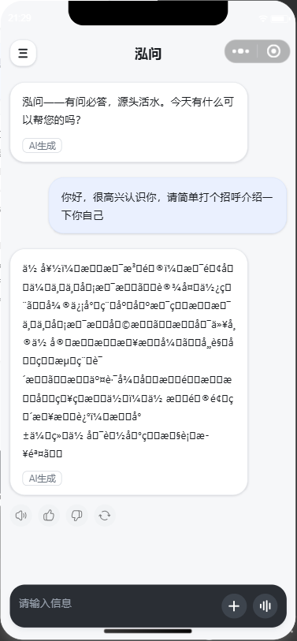
  - 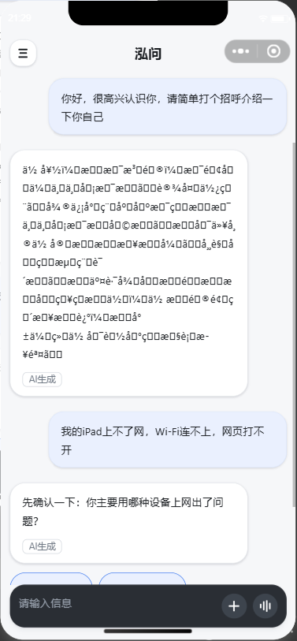
  - 
  - 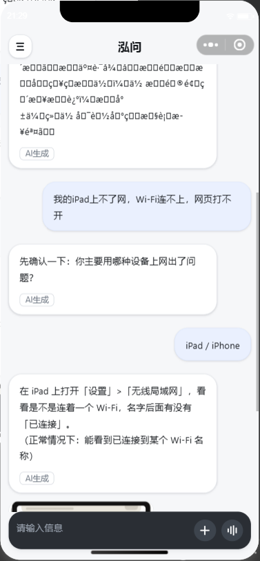

### 6. 语音录制（电平/取消/发送/转写/自动朗读） — MANUAL

- 方式：manual 耗时：5702ms
- 断言/证据：
  - composer mounted (input-wrap present, meterBars=null); recording requires a real microphone (simulator has none)
  - 电平算法 estimateVoiceLevel 是 input-bar 组件方法（非导出纯函数），未纳入 vitest；真机验证电平条随音量起伏。
- 截图：
  - 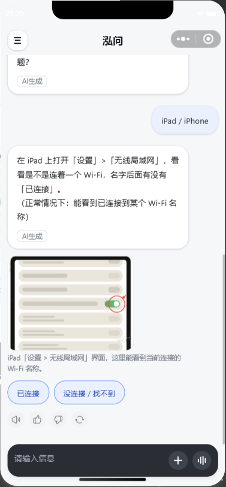
- 真机手测：
  - [ ] 真机扫码（preview-qr.jpg）进入聊天，点击语音入口开始录音
  - [ ] 对着麦克风说话，确认电平条随音量起伏（record-window meter-bar）
  - [ ] 点左侧 × 取消：不产生语音消息；点右侧 ↑ 发送：产生语音消息并转写回填
  - [ ] 确认转写文本作为用户消息提交，且回复自动朗读（autoSpeakReply）

### 7. TTS 两路径（speak/stream 与 speak 回退）/ 停止 — PASS

- 方式：mock 耗时：13964ms
- 断言/证据：
  - speak fallback: /speak -> download -> persisted cache http://usr/tts_tts-automator-msg.mp3 (exists=true); Qwen primary arrears -> Volcengine seed-tts-2.0
  - stop: re-invoking playAssistantSpeech on the active message clears assistantActionState.activeMessageId
  - speak/stream: POST -> http://127.0.0.1:8001/api/v1/hongwen/speak/stream/95d2ab3cae984670a4dad2f512ab8d4e (model dashscope/cosyvoice-v3-flash); GET 200, 18093 bytes, audio/mpeg
  - MANUAL(真机): 模拟器无声卡输出，需真机扫码确认两条路径实际可听、再次点击停止。
- 截图：
  - 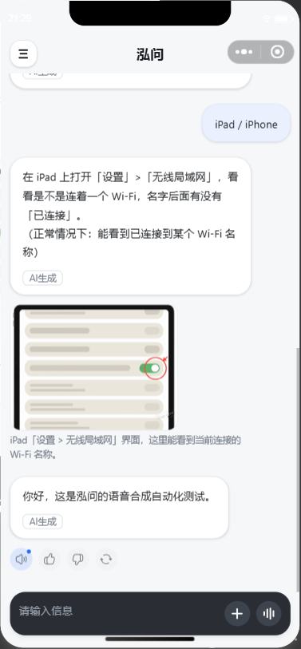
  - 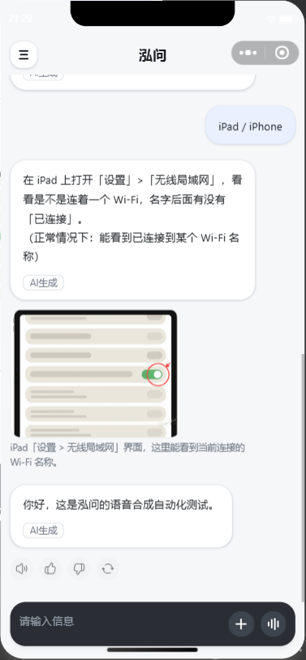
- 真机手测：
  - [ ] 真机 TTS 可听性（speak/stream 直连与 speak 下载回退）+ 停止

### 8. 重答 regenerate（仅最新可用 / 失败回滚） — PASS

- 方式：auto 耗时：31063ms
- 断言/证据：
  - eligibility: regenerateAssistantMessage(older id) -> false, "仅支持重答最新回复", content unchanged
  - chip tap regenerate: latest 1795095081890_8cb30292717c8 re-answered (207 -> 207 chars, real SSE)
  - rollback: stubbed streamRegenerateReply rejection -> returns false, content restored to original
- 截图：
  - 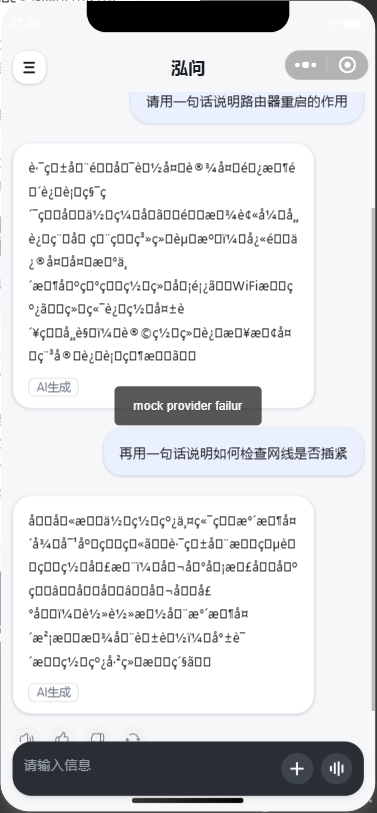
  - 

### 9. 图片上传（压缩 <=15MB / pending / 随文字 mixed 提交） — PASS

- 方式：mock 耗时：21351ms
- 断言/证据：
  - chooseMedia(album mock) -> real compressImage/saveFile -> http://store/W3BlwMWzeqkq6a08b807772d47a6952a970f5b138ba0.jpg (21280 bytes <=15MB)
  - upload: real wx.uploadFile /files/upload -> file_id=2bd80e8bb56f4ed79bf329755918de36, type=image
  - mixed submit: text + image_file_ids=[2bd80e8bb56f4ed79bf329755918de36] -> type mixed SSE reply (529 chars), pending cleared
  - MANUAL(真机): 相册/拍照两条真实入口与系统压缩需真机扫码验证。
- 截图：
  - 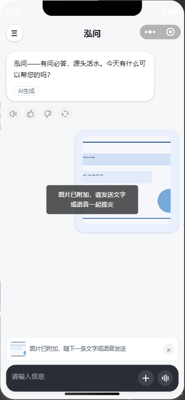
  - 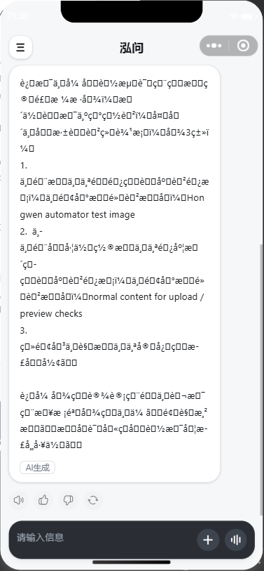
- 真机手测：
  - [ ] 真机相册/拍照入口 + 系统压缩 <=15MB

### 10. 401 刷新（有效 refresh 重试 / 无效 refresh 回登录页） — PASS

- 方式：auto 耗时：8860ms
- 断言/证据：
  - valid refresh: 401 -> /api/v1/auth/token/refresh/ 200 -> new access stored, request retried OK, stayed on chat
  - invalid refresh: 401 -> refresh fails -> clearTokens + reLaunch '?loggedOut=1', prompt="已退出登录，请重新登录。"
- 截图：
  - 
  - 
  - 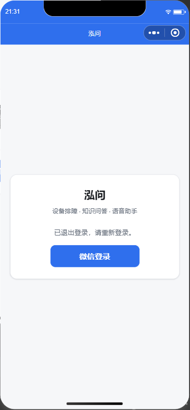

### 11. 刘海屏自定义导航栏 / 胶囊对齐 / 抽屉顶部 — PASS

- 方式：mock 耗时：6622ms
- 断言/证据：
  - notch metrics: statusBarHeight=47, capsule.height=32 -> headerTopInset=47, headerContentHeight=48, menuPanelTop=103
  - drawer alignment: .sidebar-drawer style="padding-top:103px"
  - adaptivity: statusBarHeight=20, capsule.height=30 -> inset=20, height=46, panelTop=74
  - MANUAL(真机): 刘海屏/胶囊按钮实际不遮挡标题、抽屉顶部对齐需真机扫码目视确认。
- 截图：
  - 
  - 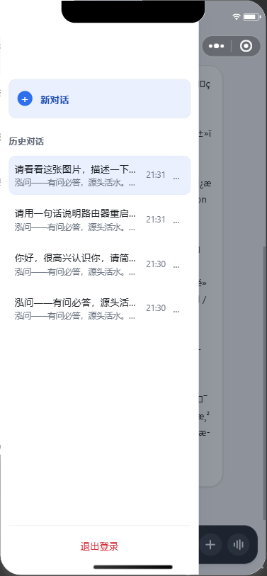
- 真机手测：
  - [ ] 真机刘海屏胶囊对齐目视确认

## 真机手测清单（preview QR）

- preview QR：**未生成** — `npm run preview` 已尝试，被微信代码上传 IP 白名单拦截：`errCode -10008 invalid ip: 240e:473:c0:10fe:31bc:9574:b17a:4a38`。需用户在 mp.weixin.qq.com → 开发管理 → 开发设置 → 小程序代码上传 **关闭 IP 白名单**（推荐，开发机公网 IP 会轮换）或把该 IP 加入白名单，然后重跑 `npm run preview` 生成 `preview-qr.jpg`（该文件已 gitignore，不提交）。
- 生成命令：`cd hongwen-miniprogram && npm run preview`（CI 私钥已配置 `private.wxd152caad9f9c76ef.key`；编译/打包成功，仅上传 IP 被拒）。
- 需真机配合的项：
  - [ ] 项 2：getUserProfile 授权弹窗 + 2022-10-25 起匿名资料展示（预期）。
  - [ ] 项 3：原生手机号授权弹窗 → 真实 code 换取手机号。
  - [ ] 项 6：录音电平条随音量起伏、取消/发送两条路径、转写回填、自动朗读。
  - [ ] 项 7：TTS 两条路径实际可听、再次点击停止。
  - [ ] 项 9：相册/拍照真实入口与系统压缩 <=15MB。
  - [ ] 项 11：刘海屏胶囊按钮不遮挡标题、抽屉顶部对齐目视确认。

## 复跑

```bash
cd hongwen-miniprogram
node tests/automation/run-all.js          # 全部 11 项
node tests/automation/run-all.js 05 08    # 子集
npm test                                  # vitest 纯逻辑仍须绿
```
